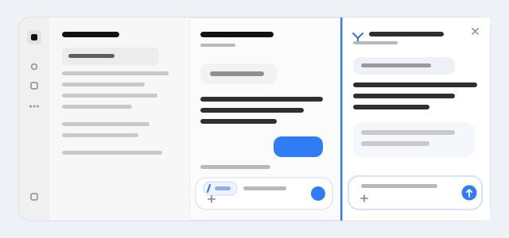

Typical use: type /btw followed by the question in any started session; the main composer clears, a side-chat tab opens on the right and the first message is sent there. Keep asking in that tab with the same input, tools, approvals and model selection as a normal session, then close the tab to archive it.

Limits: the fork point is the last completed turn, so a session that has not finished a turn yet cannot start one; while the panel is open its conversation is visible in the left session list (a platform constraint) and is archived on close; /btw itself takes no attachments — send those from the panel's own composer; Windows panel interaction is not re-tested for this version.
