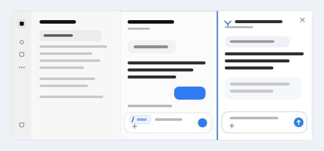

典型用法：在任意已开始的会话里输入 `/btw` 加问题，主输入框清空，右侧出现「侧边聊天」标签页并发出第一条消息；在那一栏里继续追问，输入、工具、审批与模型选择都和普通会话相同，关闭标签页即归档。

限制：分叉点是最后一个已完成轮次，还没跑完一轮的会话开不了；面板打开期间这条会话会出现在左侧列表（平台约束），关闭即归档；`/btw` 命令本身带不了附件，附件要在面板的输入框里发；Windows 的面板交互在当前版本未复测。
